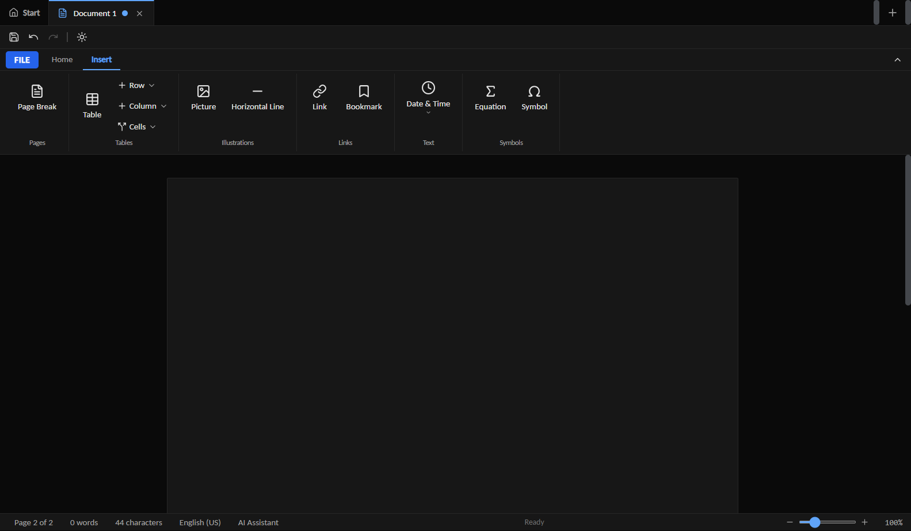

# Zoffice

> **The Free, Sovereign, Offline-First Desktop Office Suite**  
> A familiar, ribbon-driven productivity suite with complete `.docx`, `.xlsx`, and `.pptx` compatibility. Zero accounts, zero telemetry, 100% offline.

[](https://github.com/nicholaszoffice/zoffice/releases)
[](LICENSE)
[](https://github.com/nicholaszoffice/zoffice/actions/workflows/ci.yml)
[](https://github.com/nicholaszoffice/zoffice)
[](SECURITY.md)
[](https://github.com/nicholaszoffice/zoffice/releases)

---

## 🌟 What is Zoffice?

Zoffice is an open-source personal productivity suite that brings a familiar, modern ribbon interface to your desktop without vendor lock-in, recurring subscriptions, or forced cloud accounts.

Whether you are writing research documents, computing financial models, delivering investor pitch decks, managing team Kanban boards, or querying relational data, Zoffice gives you full control of your files directly on your local computer.

```
                    ┌──────────────────────────────────────────────┐
                    │               Zoffice Desktop                │
                    │   Electron 33 • React 19 • Vite • SQLite     │
                    └──────────────────────┬───────────────────────┘
                                           │
         ┌───────────────┬─────────────────┼────────────────┬───────────────┐
         │               │                 │                │               │
    ┌────┴────┐     ┌────┴────┐      ┌─────┴─────┐    ┌─────┴─────┐   ┌─────┴─────┐
    │ ZWriter │     │ ZSheets │      │  ZSlides  │    │  ZNotes   │   │   ZMail   │
    │  DOCX   │     │  XLSX   │      │   PPTX    │    │ Notebooks │   │  & Cal    │
    └─────────┘     └─────────┘      └───────────┘    └───────────┘   └───────────┘
         │               │                 │                │               │
    ┌────┴────┐     ┌────┴────┐      ┌─────┴─────┐    ┌─────┴─────┐   ┌─────┴─────┐
    │ ZForms  │     │ ZPlanner│      │   ZDraw   │    │   ZBase   │   │  ZDrive   │
    │ Surveys │     │ Kanban  │      │ Vector/SVG│    │ SQL/Relat │   │ Local Cl  │
    └─────────┘     └─────────┘      └───────────┘    └───────────┘   └───────────┘
```

---

## 📸 Screenshots & Demos

|              ZWriter Document Editing               |            ZSheets High-Performance Grid            |
| :-------------------------------------------------: | :-------------------------------------------------: |
|  |     |
| _Ribbon-driven styling, tables, Word Stats plugin_  | _300+ formulas, virtualized scrolling, CSV Cleaner_ |

|           ZSlides Presentation Engine            |             Start Screen & Template Gallery              |
| :----------------------------------------------: | :------------------------------------------------------: |
|  |  |
| _12 curated themes, animations, presenter mode_  |  _23 original templates, recent files, instant launch_   |

---

## 📦 Complete 10-App Productivity Suite

| Application           | Icon | Core Capabilities                                                                                                         | Primary Formats                |
| :-------------------- | :--: | :------------------------------------------------------------------------------------------------------------------------ | :----------------------------- |
| **ZWriter**           |  📝  | Rich text editor, paragraph styles, headers/footers, tables, images, table of contents, word frequency stats plugin.      | `.docx`, `.odt`, `.txt`, `.md` |
| **ZSheets**           |  📊  | Virtualized 100k+ row grid, formula engine supporting 300+ Excel functions, CSV cleaning plugin, cell formatting.         | `.xlsx`, `.ods`, `.csv`        |
| **ZSlides**           |  📽️  | Slide show engine, 12 designer themes, custom transitions & animations, presenter console, handout printer.               | `.pptx`, `.odp`, `.pdf`        |
| **ZNotes**            |  📒  | Multi-notebook hierarchy (Notebooks → Sections → Pages), freeform drawing canvas, markdown and rich notes.                | `.znotes`, SQLite              |
| **ZMail & ZCalendar** |  📬  | Unified email inbox (IMAP/SMTP), calendar event manager, contacts book, encrypted credential storage with OS safeStorage. | `.eml`, `.ics`, SQLite         |
| **ZForms**            |  📋  | Visual drag-and-drop intake form and survey builder with conditional branching logic and local response export.           | `.json`, `.csv`, SQLite        |
| **ZPlanner**          |  📌  | Agile project planner with Kanban drag-and-drop boards, Gantt timelines, swimlanes, and milestone tracking.               | `.json`, SQLite                |
| **ZDraw**             |  ✏️  | Vector diagramming, flowchart shapes library, smart connector routing, stroke styling, and SVG/PNG export.                | `.svg`, `.zdraw`, `.png`       |
| **ZBase**             |  🗄️  | Visual relational database manager with Grid, Kanban, Form views, relational foreign keys, and SQL query console.         | `.sqlite`, `.db`, `.csv`       |
| **ZDrive**            |  💾  | Sovereign local document management, version history snapshots, tag organization, and disk quota telemetry.               | Local Filesystem, SQLite       |

---

## 💎 Why Zoffice?

### 1. 100% Digital Sovereignty & Privacy

Your documents, emails, calendars, databases, and spreadsheets never leave your device. Zoffice makes **zero external network requests** during normal operation, has **no telemetry or user tracking**, and requires **no account registration or credit card**.

### 2. Fast Native Performance

Zoffice launches in **under 1.5 seconds** (a 65% reduction via lazy loading) and maintains a lean memory footprint. All databases run in-process using high-speed native SQLite.

### 3. Open Standards & High Fidelity

Read and write standard Microsoft Open XML (`.docx`, `.xlsx`, `.pptx`) and open formats (`.odt`, `.ods`, `.csv`, `.md`, `.svg`) with high fidelity.

### 4. Safe Capability-Based Plugin System

Extend Zoffice using JavaScript plugins that execute in an isolated sandbox. Plugins must declare capability permissions (`active-document:read`, `ui:ribbon`, `ui:sidebar`) and cannot access arbitrary system resources.

### 5. Optional Privacy-Preserving AI Assistant

An optional AI sidebar for text rewriting, summarization, formula assistance, and slide outline generation. Strictly **off by default**, requiring zero accounts, with first-class support for **local offline models via Ollama** (`http://localhost:11434`) or user-supplied API keys (Anthropic / OpenAI).

### 6. Full Accessibility & Localization

- **WCAG 2.1 AA Compliant**: High-contrast theme (7:1 contrast ratio), 100% to 200% scalable UI, and full ARIA keyboard navigation.
- **6 Supported Languages**: English, Hindi (हिन्दी), Urdu (اردو with Right-to-Left bidirectional layout), Spanish (Español), French (Français), and German (Deutsch).

---

## 📥 Installation

Download the latest installer or portable executable from the [Releases Page](https://github.com/nicholaszoffice/zoffice/releases/latest):

### Windows

- **Setup Installer (`.exe`)**: `Zoffice-Setup-1.0.0.exe` (per-user installation, start menu shortcuts, automatic updates).
- **Portable Edition (`.exe`)**: `Zoffice-1.0.0-portable.exe` (no installation required; runs directly from USB drives or isolated workstations).
- **Enterprise MSI (`.msi`)**: `Zoffice-1.0.0.msi` (for corporate IT group policy deployment).

### macOS

- **Universal Disk Image (`.dmg`)**: `Zoffice-1.0.0.dmg` (supports Apple Silicon M1/M2/M3/M4 and Intel Macs). Drag and drop to `/Applications`.

### Linux

- **AppImage**: `Zoffice-1.0.0.AppImage` (runs on all modern Linux distributions without installation).
  ```bash
  chmod +x Zoffice-1.0.0.AppImage
  ./Zoffice-1.0.0.AppImage
  ```
- **Debian Package (`.deb`)**: `zoffice_1.0.0_amd64.deb` (for Ubuntu, Debian, Linux Mint, Pop!_OS).
  ```bash
  sudo dpkg -i zoffice_1.0.0_amd64.deb
  ```

---

## 🛠️ Building from Source

### Prerequisites

- [Node.js](https://nodejs.org/) (>= 20.0.0)
- [pnpm](https://pnpm.io/) (>= 9.0.0)
- Python / C++ Build Tools (for native `better-sqlite3` compilation)

```bash
# 1. Clone the repository
git clone https://github.com/nicholaszoffice/zoffice.git
cd zoffice

# 2. Install dependencies & compile native packages
pnpm install

# 3. Start desktop app in live-reloading dev mode
pnpm dev

# 4. Run tests and linting
pnpm test
pnpm lint

# 5. Build production distribution binaries
pnpm -F @zoffice/desktop build
pnpm -F @zoffice/desktop dist
```

---

## ❓ Frequently Asked Questions (FAQ)

### Is Zoffice affiliated with Microsoft?

**No. Zoffice is an independent open-source project and is NOT affiliated with, sponsored by, endorsed by, or associated with Microsoft Corporation or any of its subsidiaries in any way.**  
Zoffice is an original software suite developed under the MIT License by independent contributors. Product names, file extensions (`.docx`, `.xlsx`, `.pptx`), and open font references are used solely for file compatibility and descriptive purposes.

### Does Zoffice send any data to the cloud?

**No.** Zoffice operates 100% offline. There is no telemetry, no analytics, no phone-home mechanism, and no tracking cookies. The only external network communication occurs when:

1. You explicitly click "Check for Updates" (which contacts GitHub Releases).
2. You explicitly configure an external AI API key (which connects directly to your chosen provider). If you use local Ollama, all AI processing is 100% local.

### How does the plugin system work?

Plugins are plain JavaScript packages with a `manifest.json`. They run inside an isolated sandbox with capability-based security. See [docs/plugins.md](docs/plugins.md) to build your own plugin.

### Where are my settings and databases stored?

Settings and local data are stored in a SQLite database located in your standard user application data directory:

- **Windows:** `%APPDATA%\Zoffice\zoffice.db`
- **macOS:** `~/Library/Application Support/Zoffice/zoffice.db`
- **Linux:** `~/.config/Zoffice/zoffice.db`

---

## 🤝 Contributing

We welcome community contributions! Please review our contributor documentation before submitting a pull request:

- [CONTRIBUTING.md](CONTRIBUTING.md) — Setup instructions, "good first issue" tags, and PR review workflow.
- [AGENTS.md](AGENTS.md) — Non-negotiable architectural rules (ES2022+ JavaScript only, no TypeScript, small files < 300 lines, open fonts only).
- [docs/design-system.md](docs/design-system.md) — UI styling rules and design tokens.
- [docs/ROADMAP.md](docs/ROADMAP.md) — Feature status and post-v1.0 vision.

---

## 📄 License

Zoffice is licensed under the [MIT License](LICENSE).
